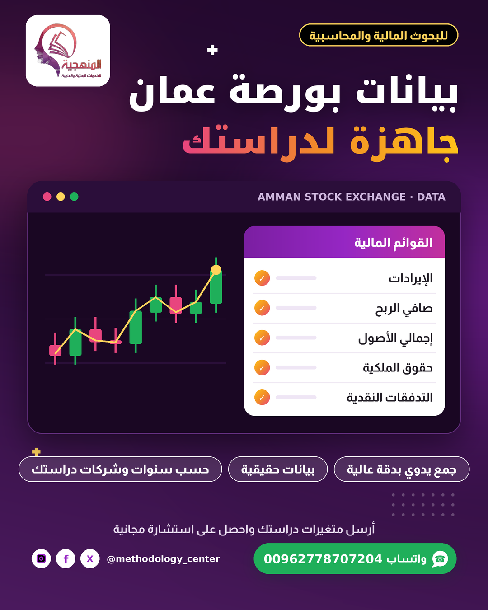
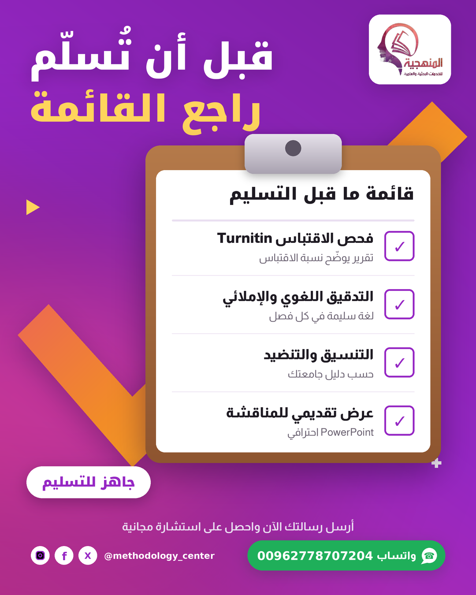
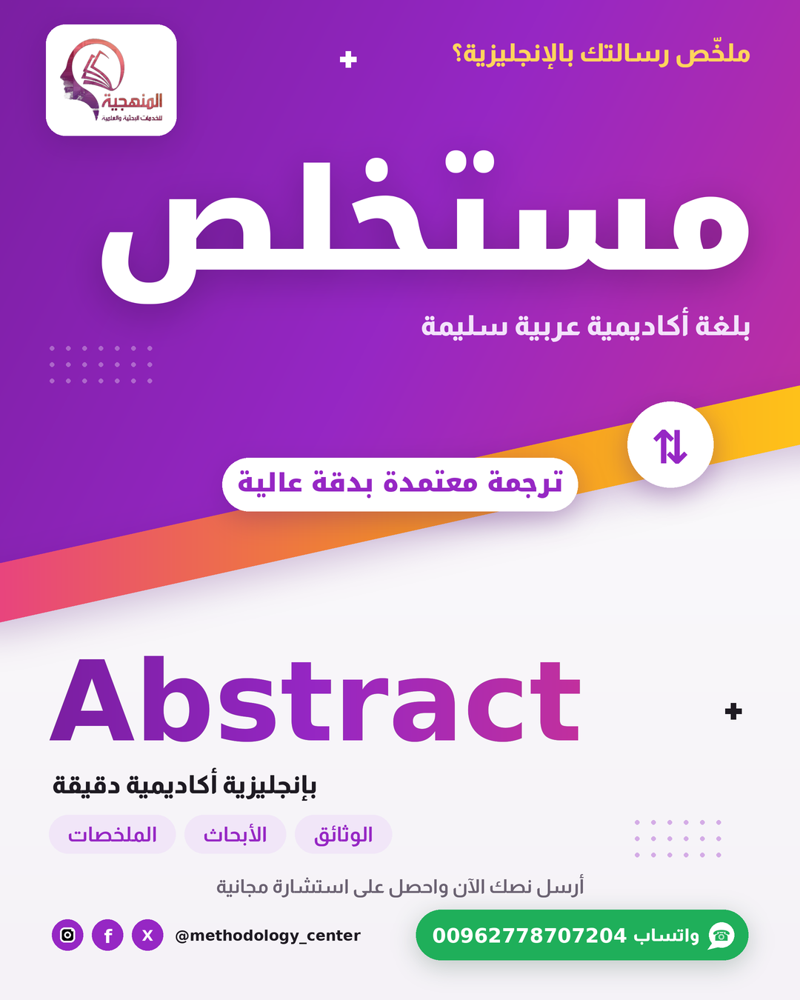
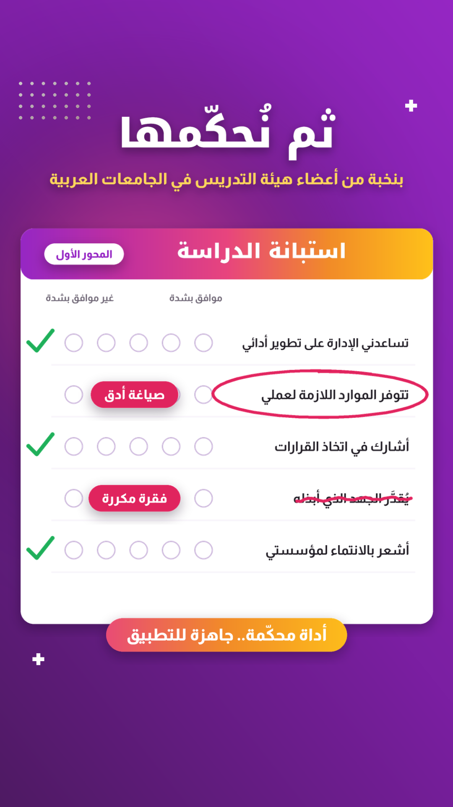
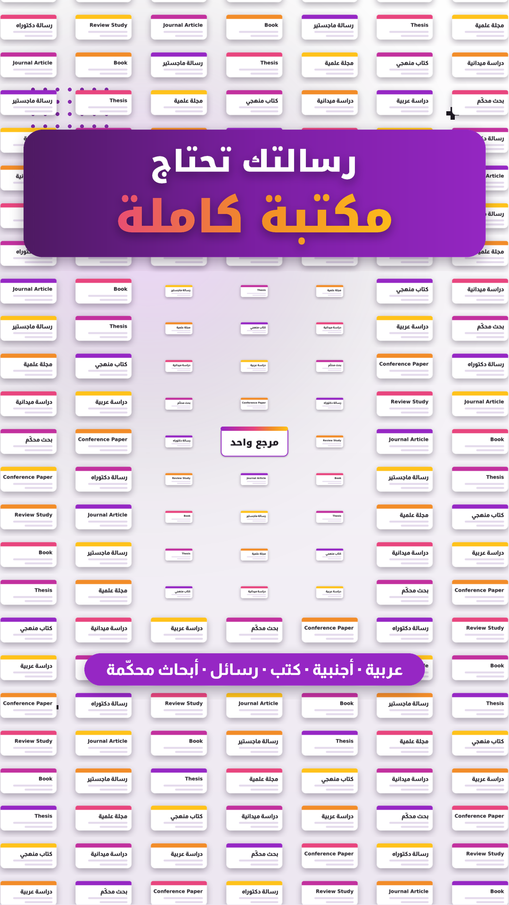

# الدفعة 03 — أسبوع 9–14 تشرين الثاني 2026 (توقيت عمّان)

## 01.png — جمع البيانات المالية من بورصة عمان
**النشر:** الإثنين 9 تشرين الثاني 2026 – 10:00 · فيسبوك + إنستغرام · قالب `ticker_board` · نسخة الحالة: `story-01.png`



```
📈 بحثك مالي أو محاسبي؟ البيانات هي نصف الطريق!

ساعات طويلة بين القوائم المالية للشركات، وأرقام تُنقل يدوياً سنة بعد سنة، وخطأ واحد في خانة قد يغيّر نتائج دراستك كلها.

في المنهجية نجمع لك البيانات التي تحتاجها:
✅ جمع البيانات المالية الحقيقية من بورصة عمان يدوياً وبدقة عالية
✅ حسب الشركات والقطاعات والسنوات التي تحددها دراستك
✅ للبحوث المالية والمحاسبية في الماجستير والدكتوراه
✅ ومع التحليل الإحصائي وربط النتائج بالفرضيات إن احتجت

🎯 أرسل متغيرات دراستك اليوم.. والاستشارة الأولى مجانية

📞 للتواصل والاستفسار:
📱 رقم الهاتف: 00962778707204
💬 تواصل معنا مباشرة عبر واتساب: wa.me/962778707204

#المنهجية #بورصة_عمان #جمع_البيانات #بحوث_محاسبية #بحوث_مالية #رسائل_ماجستير #دكتوراه
```

## 02.png — التدقيق اللغوي وفحص Turnitin والتنسيق
**النشر:** الثلاثاء 10 تشرين الثاني 2026 – 10:00 · فيسبوك + إنستغرام · قالب `clipboard_check` · نسخة الحالة: `story-02.png`



```
✅ أنهيت الكتابة؟ لا تضغط «تسليم» قبل هذه القائمة!

أخطاء إملائية تلفت نظر المشرف، ونسبة اقتباس لم تتحقق منها، وتنسيق لا يطابق دليل جامعتك.. تفاصيل صغيرة قد تؤخر قبول رسالتك.

في المنهجية نراجع رسالتك قبل التسليم:
✅ فحص الاقتباس ببرنامج Turnitin
✅ التدقيق الإملائي واللغوي للأبحاث والرسائل
✅ التنسيق الشكلي والتنضيد حسب دليل جامعتك
✅ تصميم عرض تقديمي احترافي (PowerPoint) لمناقشتك

🎯 أرسل رسالتك اليوم.. والاستشارة الأولى مجانية

📞 للتواصل والاستفسار:
📱 رقم الهاتف: 00962778707204
💬 تواصل معنا مباشرة عبر واتساب: wa.me/962778707204

#المنهجية #تدقيق_لغوي #Turnitin #فحص_الاقتباس #تنسيق_الرسائل #رسائل_ماجستير #دكتوراه
```

## 03.png — الترجمة المعتمدة
**النشر:** الأربعاء 11 تشرين الثاني 2026 – 10:00 · فيسبوك + إنستغرام · قالب `diagonal_split` · نسخة الحالة: `story-03.png`



```
🌐 ملخّص رسالتك جاهز بالعربية.. فماذا عن الإنجليزية؟

المستخلص الإنجليزي هو أول ما يقرؤه المحكّم الأجنبي ولجنة المناقشة، والترجمة الحرفية أو الآلية تضيّع المصطلحات وتُضعف صورة بحثك.

في المنهجية نترجم لك بلغة أكاديمية:
✅ ترجمة معتمدة بدقة عالية
✅ ترجمة الملخصات (Abstract) والأبحاث بمصطلحات تخصصك
✅ تدقيق لغوي للنص المترجم
✅ تصميم عروض تقديمية احترافية (PowerPoint) لمناقشتك

🎯 أرسل نصك اليوم.. والاستشارة الأولى مجانية

📞 للتواصل والاستفسار:
📱 رقم الهاتف: 00962778707204
💬 تواصل معنا مباشرة عبر واتساب: wa.me/962778707204

#المنهجية #ترجمة_معتمدة #ترجمة_أكاديمية #Abstract #بحث_علمي #رسائل_ماجستير #دكتوراه
```

## reel-1.mp4 — أدوات الدراسة وتحكيمها
**النشر:** الخميس 12 تشرين الثاني 2026 – 19:00 · Reel فيسبوك + إنستغرام · الغلاف `reel-1-cover.png`

**الفكرة:** document filling itself in line by line (a questionnaire builds itself, answer dots get picked) → reviewer's red pen marks it up → submit button pressed turns into the WhatsApp CTA (CTA lands at the end, via a button press)



```
📝 استبانتك جاهزة للتوزيع؟ توقّف لحظة قبل أن ترسلها!

فقرة غامضة واحدة قد تقيس شيئاً غير الذي تريده، وأداة غير محكّمة قد تكلّفك إعادة جمع البيانات من البداية وأسئلة محرجة من لجنة المناقشة.

في المنهجية نبني أداة دراستك ونراجعها معك:
✅ إعداد أدوات الدراسة: الاستبانات والبرامج التدريبية والإرشادية
✅ صياغة الفقرات بوضوح وربطها بمحاور الدراسة وأهدافها
✅ تحكيم الأدوات بنخبة من أعضاء هيئة التدريس في الجامعات العربية
✅ توزيع الاستبانات إلكترونياً عبر نماذج جوجل (Google Forms)

🎯 أرسل أداتك اليوم.. والاستشارة الأولى مجانية

📞 للتواصل والاستفسار:
📱 رقم الهاتف: 00962778707204
💬 تواصل معنا مباشرة عبر واتساب: wa.me/962778707204

#المنهجية #أدوات_الدراسة #تحكيم_الاستبانة #استبانة #رسائل_ماجستير #دكتوراه #بحث_علمي
```

## reel-2.mp4 — المراجع والدراسات السابقة
**النشر:** السبت 14 تشرين الثاني 2026 – 19:00 · Reel فيسبوك + إنستغرام · الغلاف `reel-2-cover.png`

**الفكرة:** one object revealed from an unexpected scale (powers-of-ten dolly pull-back: one reference card → a wall of hundreds) → scattered cards fly into sorted columns (CTA lands mid-reel) → the empty slot in the wall is circled and 'your study' slams into the research gap



```
📚 هل يكفي مرجع واحد لبناء رسالة؟

فصل الدراسات السابقة هو المكان الذي تثبت فيه أنك تعرف مجال بحثك: كتب ودراسات عربية وأجنبية حديثة، مراجعة نقدية لا نسخ ولصق، وفجوة بحثية واضحة تبرّر دراستك أمام لجنة المناقشة.

في المنهجية نختصر عليك رحلة البحث عن المصادر:
✅ توفير المراجع والكتب والدراسات السابقة العربية والأجنبية
✅ تنظيمها حسب محاور دراستك
✅ مراجعة نقدية تكشف الفجوة البحثية وموقع دراستك منها
✅ إعداد الإطار النظري بمصادر موثّقة

🎯 أرسل عنوان دراستك اليوم.. والاستشارة الأولى مجانية

📞 للتواصل والاستفسار:
📱 رقم الهاتف: 00962778707204
💬 تواصل معنا مباشرة عبر واتساب: wa.me/962778707204

#المنهجية #الدراسات_السابقة #المراجع #الفجوة_البحثية #الإطار_النظري #رسائل_ماجستير #دكتوراه #بحث_علمي
```
